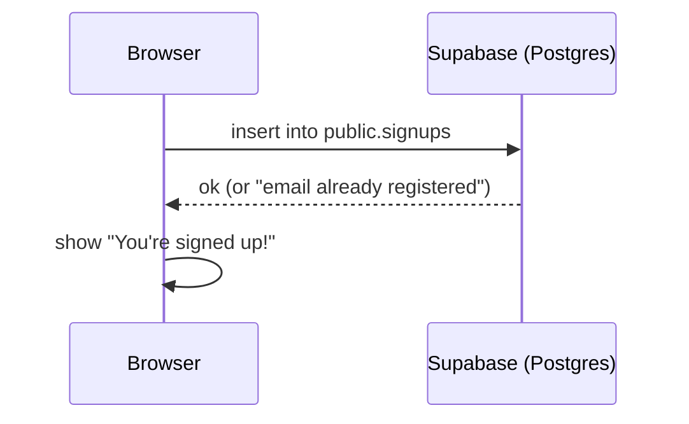

# Supabase Sign-up Form

A sign-up page built with plain **HTML, CSS and JavaScript** and **Supabase** as the backend.
No custom server: the browser writes straight to a Supabase table via `supabase-js`.

## Flow

1. User enters **first name, last name, phone and email** → **Sign up**
2. The data is inserted into the `public.signups` table
3. The page shows **"You're signed up!"**



## Project structure

```
├── index.html        # page markup (2 steps: Details → Done)
├── style.css         # design + animations
├── script.js         # validation + insert into Supabase
├── config.js         # project URL + anon key
├── .github/
│   └── workflows/
│       └── supabase-db.yml                      # applies migrations on push (optional)
└── supabase/
    ├── config.toml
    └── migrations/
        ├── 20261112000000_create_profiles.sql   # old: profiles linked to Supabase Auth (unused)
        └── 20261112010000_create_signups.sql    # signups table used by the form
```

## Database

### `public.signups`

| Column       | Type          | Notes                               |
|--------------|---------------|-------------------------------------|
| `id`         | `uuid`        | Primary key, generated automatically |
| `first_name` | `text`        | Required                            |
| `last_name`  | `text`        | Required                            |
| `phone`      | `text`        | Required                            |
| `email`      | `text`        | Required, unique (stored lowercase) |
| `created_at` | `timestamptz` | Defaults to `now()`                 |

**Row Level Security** is enabled:
- The browser (anon key) can **insert** new rows only.
- Nobody can read, update or delete rows from the browser. View the data in the
  dashboard under **Table Editor → signups**.

## Setup

### 1. Create the table
In the Supabase dashboard open **SQL Editor**, paste the contents of
`supabase/migrations/20261112010000_create_signups.sql` and click **Run**.

### 2. Frontend config
Fill in `config.js` from **Project Settings → API Keys**:
- `url` — Project URL (without `/rest/v1/`)
- `anonKey` — anon / publishable key (safe for the browser; never use the `service_role` / secret key)

### 3. Run
Open `index.html` with a local server (e.g. VS Code **Live Server**), fill in the form,
then check **Table Editor → signups** in Supabase.

## Optional: deploy migrations with GitHub Actions
Push the repo to GitHub and add these secrets under
**Settings → Secrets and variables → Actions**:

| Secret                  | Where to find it                                       |
|-------------------------|--------------------------------------------------------|
| `SUPABASE_ACCESS_TOKEN` | supabase.com → Account → Access Tokens                 |
| `SUPABASE_PROJECT_ID`   | Project Settings → General → Reference ID              |
| `SUPABASE_DB_PASSWORD`  | The database password chosen when creating the project |

The workflow runs `supabase db push` whenever a file in `supabase/migrations/` changes.
If you already ran migrations by hand in the SQL Editor, mark them as applied first
(`supabase migration repair --status applied <version>`) so they are not run twice.
