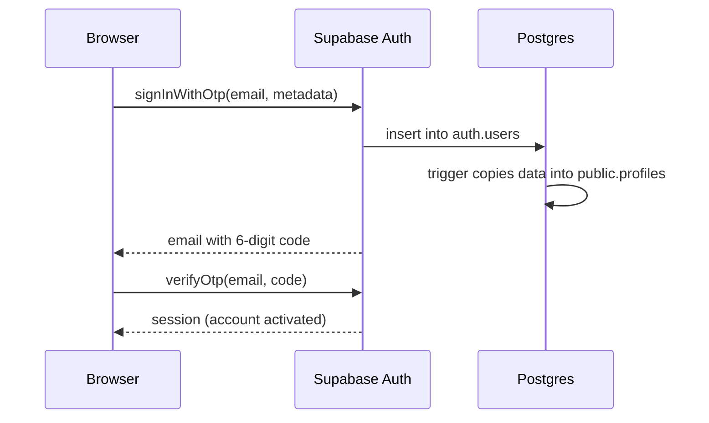
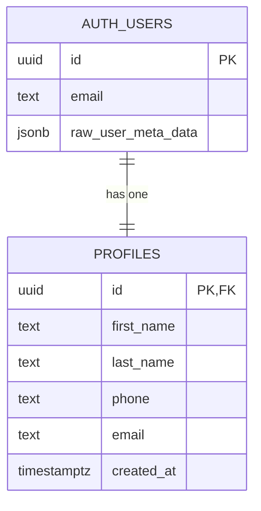

# Supabase Sign-up with Email OTP

A sign-up page built with plain **HTML, CSS and JavaScript** and **Supabase** as the backend.
No custom server: the browser talks to Supabase directly via `supabase-js`.

## Flow

1. User enters **first name, last name, phone and email** → **Submit**
2. Supabase emails a **one-time code**
3. User types the code into animated digit boxes → **Submit**
4. Code is verified → **"Your account is activated"**



## Project structure

```
├── index.html        # page markup (3 steps)
├── style.css         # design + animations
├── script.js         # Supabase calls and step logic
├── config.js         # project URL + anon key
├── .github/
│   └── workflows/
│       └── supabase-db.yml                      # applies migrations on push
└── supabase/
    ├── config.toml
    └── migrations/
        └── 20261112000000_create_profiles.sql   # database schema
```

## Database

### `public.profiles`

| Column       | Type          | Notes                                         |
|--------------|---------------|-----------------------------------------------|
| `id`         | `uuid`        | Primary key, references `auth.users.id` (cascade delete) |
| `first_name` | `text`        | Required                                      |
| `last_name`  | `text`        | Required                                      |
| `phone`      | `text`        | Optional                                      |
| `email`      | `text`        | Required, unique                              |
| `created_at` | `timestamptz` | Defaults to `now()`                           |



- **`auth.users`** is managed by Supabase Auth.
- **Trigger `on_auth_user_created`** runs `handle_new_user()` after every new user and copies
  `first_name`, `last_name`, `phone` from the sign-up metadata into `profiles`.
- **Row Level Security** is enabled: a signed-in user can only read/update their own row.

## Setup

### 1. Supabase project
1. Create a project at [supabase.com](https://supabase.com).
2. **Authentication → Email Templates → Magic Link**: replace the body with a template that shows the code:
   ```html
   <h2>Your verification code</h2>
   <p>Enter this code to activate your account:</p>
   <h1 style="letter-spacing:6px">{{ .Token }}</h1>
   ```
3. **Authentication → Providers → Email**: check **Email OTP Length** matches `otpLength` in `config.js` (default 6).

### 2. Frontend config
Fill in `config.js` from **Project Settings → API**:
- `url` — Project URL
- `anonKey` — anon / publishable key (safe for the browser; never use the `service_role` key)

### 3. Deploy the database (GitHub Actions)
In the GitHub repo: **Settings → Secrets and variables → Actions → New repository secret**:

| Secret                  | Where to find it                                         |
|-------------------------|----------------------------------------------------------|
| `SUPABASE_ACCESS_TOKEN` | supabase.com → Account → Access Tokens                   |
| `SUPABASE_PROJECT_ID`   | Project Settings → General → Reference ID                |
| `SUPABASE_DB_PASSWORD`  | The database password chosen when creating the project   |

Then push to `main`. The workflow runs `supabase db push` whenever a file in
`supabase/migrations/` changes. It can also be run manually from the **Actions** tab.

> Alternative: paste the migration file into **SQL Editor → Run** in the dashboard.

### 4. Run
Open `index.html` with a local server (e.g. VS Code **Live Server**).

## Notes
- Supabase's built-in email service is rate-limited (a few emails per hour). Use custom SMTP for real use.
- A user row is created when the code is sent; the account is confirmed once the code is verified.
